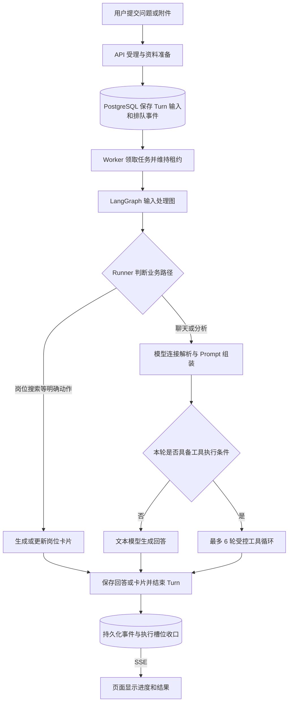
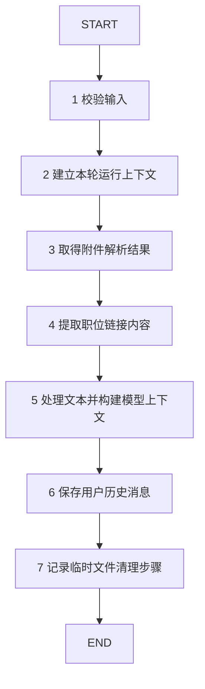
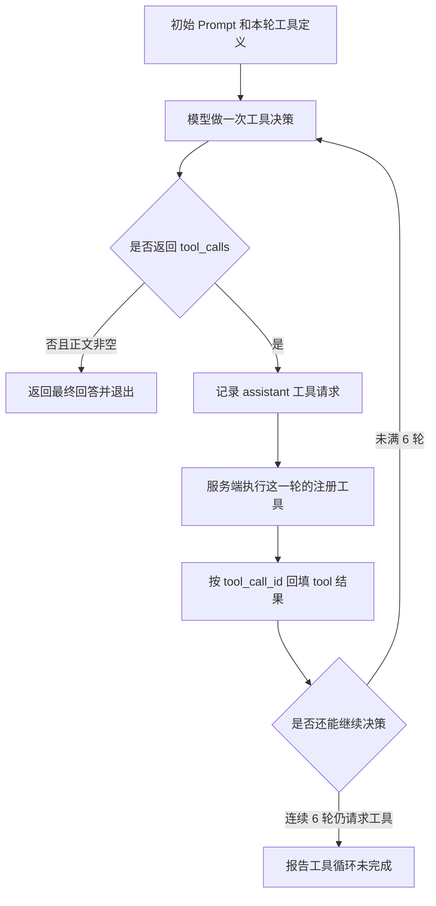
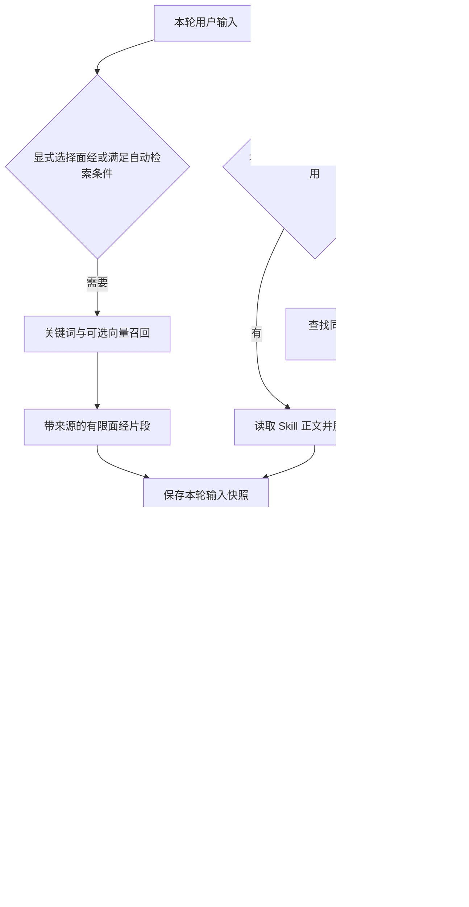

# Agent Runtime 功能与循环学习笔记

本文以当前求职助手的持久化对话主链为主，说明功能模块、LangGraph 节点、数据关系和循环。面试大师、岗位 Judge 与公众号流水线使用不同的执行入口，单独说明。依据为 2026-11-13 工作区源码；不把旧设计中的规划当作现有能力。

覆盖所有求职业务分支的总图见[求职助手全模块节点架构图](career_assistant_node_architecture.md)。

## 1 架构思想

Agent Runtime 是把一次用户请求变成可执行、可观察任务的运行机制，负责接收输入、管理 Turn、准备上下文、选择模型、执行工具和保存结果。

- 固定流程交给代码和 LangGraph：校验、资料处理、状态管理、上下文预算。
- 需要语义判断的步骤交给模型：理解问题、生成回答、决定本轮是否调用已提供的工具。
- 工具由服务端注册和执行：模型返回调用请求，实际副作用由代码完成。
- 提交、执行、观察分开：API 接单，Worker 执行，页面通过事件读取进度。
- 持久状态与本轮工作状态分开：数据库保存任务和消息，Graph State 与工具 messages 承载本轮处理数据。

## 2 一轮任务的功能总图

下图是功能模块，不代表每个框都是 LangGraph 节点。



明确搜索动作可以直接生成卡片，不必调用回答模型；歧义请求可能先用模型做意图判断。模型不可用或上下文超限时，Runner 输出对应失败或配置提示，不继续正常生成。

### 功能分工

| 模块 | 负责的任务 | 主要输出 |
| --- | --- | --- |
| API 受理 | 解析附件、读取绑定资料、解析显式或会话继承的 Skill、按需检索面经，保存本轮输入 | 可恢复的 Turn payload |
| Turn 仓储与 Worker | 排队、领取、同会话执行顺序、并发槽位、心跳及终态事件 | 已领取任务和执行事件 |
| CareerAgentLoop | 创建或恢复会话、激活 Turn、标记成功或失败 | ActiveAgentTurn |
| CareerIntakeGraph | 执行固定的输入处理步骤 | ModelTurnContext 与用户历史消息 |
| CareerResponseRunner | 判断业务路径，协调模型、Prompt 和工具，生成并保存回复 | 回答、卡片及执行结果 |
| ModelGateway | 根据平台默认、指定档案或旧免费优先策略解析模型与能力、凭据 | ModelResolution |
| PromptContextService | 拼接规则、Skill、摘要、未摘要历史、简历、JD 和证据，计算预算 | PreparedPromptContext |
| SkillToolRegistry | 提供工具定义、校验参数、执行注册工具并返回 JSON | 工具结果及 Trace |
| ConversationMemoryService | 将旧摘要与选中的旧对话更新成新摘要 | 摘要版本和覆盖位置 |

CareerAgentLoop 的名称容易造成误解：它主要管理生命周期，模型与工具的循环位于 CareerResponseRunner 中。

## 3 LangGraph 的七个真实节点

当前图只有一条顺序链，没有条件边和回边。



| 顺序与代码名称 | 具体职责 | 交给后续的内容 |
| --- | --- | --- |
| 1 `validate_input` | 校验输入 Contract，确认文本、附件、模型选择等字段有效 | 校验后的同一份输入 |
| 2 `build_context` | 区分历史展示文本和本轮模型任务文本，整理附件类型与链接存在信息 | TurnRuntimeContext |
| 3 `parse_material` | 主 Worker 路径复用 API 已解析附件；兼容入口仍可在这里调用解析器 | ParsedAttachment 集合 |
| 4 `extract_job_description` | 有职位 URL 时尝试提取网页文字，没有 URL 则跳过实际抓取；失败保留状态提示 | 岗位快照或读取失败原因 |
| 5 `redact_sensitive_data` | 按配置处理文字，归纳简历、整合 JD 和证据，生成面向模型与面向历史的两份数据 | ModelTurnContext、历史消息文本 |
| 6 `persist_history` | 保存本轮用户消息并关联 Turn；内部岗位自动续答不伪造用户输入 | MessageRecord |
| 7 `cleanup_temporary_files` | 标记清理步骤已到达；真实文件删除由 API 或输入图 finally 保证 | 节点进展与最终输入处理结果 |

主路径中，耗时 OCR 已在入队前完成。节点 3 仍存在，是为了统一消费解析产物和兼容其他调用入口，不能据图误认为所有 OCR 都在 Worker 内执行。

## 4 节点之间传递什么

```text
CareerInboundMessage  用户任务、模型选择、资料和 Skill 快照
        ↓
CareerIntakeGraphState  各节点共享的本轮工作状态
        ↓
ModelTurnContext  处理后的问题、简历、JD、附件文本和证据
        ↓
PreparedPromptContext  最终模型 messages、预算和裁剪记录
        ↓
模型或工具执行结果
        ↓
历史消息、Turn 状态、持久事件
```

Graph 节点读取 State，再返回局部字段更新，由图合并供下一节点读取。所有 State 字段不会自动整体发送给模型；模型只接收 Prompt 服务选择的 messages。

长期保存的 task payload、会话消息、摘要，与本轮内存 State 是不同记录。当前没有 LangGraph checkpointer，工具循环的中间 messages 也没有按每一轮持久化成可续跑 checkpoint。

## 5 真正的模型工具循环

进入条件：本轮有已激活 Skill、Registry 提供工具定义，而且模型可使用 Tool Calling。显式调用过的 Skill 可以在同会话后续轮次继承；自动简历初评只挂载指令，不因此开放通用 Skill 管理工具。



当前工具主要是 `search_skill_registry`、`inspect_skill_repository`、`install_skill_repository`。简历解析、面经检索和浏览器岗位搜索没有因此自动变成这套工具循环中的工具。

一轮模型决策可以返回多个工具调用，服务端逐个执行；“6 轮”是模型工具决策的上限，不是最多执行 6 个工具。可捕获的工具执行错误也会作为失败 JSON 回给模型，供下一轮处理。没有工具调用但正文为空，同样按失败处理。

示例：用户明确启用相关 Skill 并要求检查和安装一个仓库。

```text
模型第 1 轮 → 请求 inspect_skill_repository
服务端检查 → 回填仓库与 Skill 信息
模型第 2 轮 → 请求 install_skill_repository
服务端安装 → 回填安装结果
模型第 3 轮 → 输出最终说明，没有 tool_calls → 结束
```

普通聊天使用模型原生流式输出；当前工具路径先同步完成工具循环，再把最终正文作为 delta 返回。页面看到进度，不代表每个工具决策中的正文都已原生流式输出。

## 6 各种循环的目的不同

| 循环或流程 | 重复做什么 | 停止条件 | 属于模型自主执行循环吗 |
| --- | --- | --- | --- |
| 对话 Worker 调度循环 | 从数据库领取并执行不同 Turn | Worker 停止 | 否，属于任务调度 |
| Worker 心跳循环 | 定期延长当前任务租约 | 执行结束或续租失败 | 否，属于执行权管理 |
| LangGraph 输入图 | 当前只有七步顺序处理 | 到 END | 没有循环 |
| Skill Tool Calling 循环 | 模型决策、工具执行、结果回填 | 最终正文、异常或 6 轮上限 | 是，属于本轮受控工具循环 |
| 模型请求重试 | 重发暂时失败的请求 | 成功、不可重试错误或次数用完 | 否，属于网络失败处理 |
| 摘要 Worker 循环 | 领取不同的会话压缩任务 | Worker 停止 | 否，属于后台任务调度 |
| 用户多轮对话 | 每次新问题启动新的 Turn | 用户不再提问或达到产品上限 | 属于跨 Turn 交互 |

当前模型请求默认最多尝试 2 次；流式正文一旦开始输出，就不自动重放同一请求。摘要在需要时更新，Prompt 准备阶段至多尝试一次本轮压缩，不存在无限递归“压到满意”为止的逻辑。

## 7 其他功能怎样关联主 Runtime

| 功能 | 接入方式 | 与主链关系 |
| --- | --- | --- |
| 简历初评 | 用户确认资料后创建带一次性 Skill 的内部 Turn | 复用数据库 Turn、Worker、输入图与 Runner |
| 岗位搜索与自动推荐 | Runner 生成卡片；浏览器与扩展搜索；保存结果后按需创建内部分析 Turn | 是事件驱动的后续任务，不是模型在 Tool Loop 内持续操作浏览器 |
| 面经 RAG | API 受理阶段按需检索片段，放入本轮输入 | 上下文来源，不是新增 LangGraph 节点 |
| 动态指标 Judge | 独立服务读取简历/JD，结构化提取后服务端复算 | 当前使用 FastAPI BackgroundTasks，不走上述聊天工具循环 |
| 滚动摘要 | 独立压缩队列与 Memory Worker；必要时前台尝试一次压缩 | 为后续 Prompt 提供会话摘要 |
| 面试大师 | WebSocket、ASR、连接内 asyncio FIFO、流式回答 | 独立实时链路，不使用聊天 Turn 的数据库租约恢复 |
| 公众号内容生产 | Scheduler/Application 组织各 BaseTask，共享 TaskContext | 另一套任务流水线，不属于 CareerIntakeGraph |

## 8 读代码顺序

1. `src/career_assistant/web/turn_router.py`：API 如何准备并保存任务。
2. `src/career_assistant/turn_worker.py`：谁领取任务，谁调用输入图和 Runner。
3. `src/career_assistant/intake_graph.py` 的 `_build_graph`：七个节点及固定边。
4. `src/career_assistant/response_runner.py` 的 `stream`：业务分支和生成路径。
5. `src/career_assistant/prompt_context.py` 的 `prepare`：上下文组装与预算。
6. `response_runner.py` 的 `_complete_skill_agent`：真实的六轮工具循环。
7. `src/career_assistant/skill_tools.py`：工具定义、实际执行与结果回填。
8. `src/career_assistant/web/turn_router.py` 的 `_persistent_event_stream`：页面如何观察已执行任务。

## 9 当前边界与验证

- 当前架构是固定输入流程与可选工具循环的组合，不能描述为所有业务均由一个 LangGraph 自主规划图执行。
- LangGraph 未配置 checkpointer，整轮任务恢复与节点级恢复不同；已发现的租约回收、重复写消息和 SSE 游标问题仍在讨论清单中，尚未修复。
- 工具循环限制了决策轮数，但每轮追加工具结果后尚未重新执行完整上下文预算检查，已记录为 RUN-001；使用模拟长工具结果已验证输入增长后仍会直接进入下一次模型调用。
- 学习图依据源码整理；既有架构面试指南中关于摘要尚未接入、固定六条历史和 SSE 前端续传的部分叙述已过时，集中修复时一并更新。
- 本次只新增学习文档、维护问题清单，不改变业务实现，不连接生产或部署。
- 定向验证：工具循环、Skill 解析、Prompt 和 Worker 相关 Python 测试 22 项通过；不包含真实外部工具执行或模型调用。

## 10 面经检索与 Skill 注入

面经提供参考数据，Skill 提供执行指令，注册 Tool 提供实际外部操作能力。三者在 API 准备输入时分别处理，不由聊天模型自由决定从整个知识库加载什么或读取全部 Skill。



### 面经检索

- 显式入口：前端输入 `@关键词` 搜索候选，用户选择后提交面经 ID；后端重新读取资料，不把浏览器提交的正文当成检索证据。最多选择 5 份资料，取回的片段总数最多 6 个。
- 自动入口：本轮没有显式选择时，必须已有目标岗位，并命中面试准备关键词。当前使用“面试、面经、追问、怎么答、如何回答、会问、考察、准备、interview”等字符串规则，不是独立的 LLM 意图分类器。自动最多取 4 个片段。
- 检索词由绑定公司、岗位和当前问题拼成；显式选择时限定面经 ID 范围。自动检索的公司岗位属于查询文本，不是强制公司筛选条件。
- 入库按 Markdown 标题和 Token 预算切片，并附公司、岗位和标题路径。默认正文目标 260 Token、上限 340、重叠 36；切片还包含用于理解的上下文前缀。
- 关键词通道使用 PostgreSQL trigram/LIKE；可选向量通道使用 Embedding 与 pgvector 余弦近邻。两路各取最多 24 个候选，按 RRF 合并，默认 k=60；RRF 按排名倒数相加，不直接把两种原始分数相加。
- 向量增强在仓库默认配置中关闭，是否启用取决于部署环境。向量不可用时仍可使用关键词；显式选中的资料在双路未命中时可退回所选资料的前若干切片。
- 每条证据包含面经 ID、引用标题、内容和来源链接；正文在构造证据时最多取 1600 字符。合计片段数限制不保证每份所选面经都至少被覆盖一次。
- 最终 Prompt 的 `interview` 组件使用 `instruction_authority=none` 封装，属于可选数据，预算不足时优先整体裁剪。面经不能激活 Skill，也不能成为用户做过某段经历的事实依据。

### Skill 指令与工具

- `/关键词` 候选只查询名称、描述等元数据；服务端实际激活依据用户文本中的有效 `/name`，残留 selected_skill_ids 不独立激活 Skill，`@面经` 也不作为 Skill 命令。
- 当前明确调用覆盖会话继承；否则回溯最近最多 200 条消息中的用户文本，找到最近一次有效显式调用。继承重新读取正文，并用本轮任务展开 `$ARGUMENTS`，来源标记为 session。当前没有语义相关性检查决定是否继承，也不能认为清空本轮候选 ID 就会关闭历史继承。
- 加载 `SKILL.md` 时移除 YAML frontmatter，展开任务参数和 Skill 目录变量。每轮最多 3 个 Skill，单个正文最多 48000 字符，合计最多 80000；超长拒绝，不静默截断。
- 已加载正文包在 `<activated_skill name="…">` 中，以 system 消息注入；对应 Prompt 组件是 pinned。指令长度和工具定义计入初始预算，必要上下文放不下时会阻止正常调用。
- 当前通用工具是 Skill 搜索、仓库检查和安装。Registry 对 slash/session 等非 automatic 来源开放工具定义；自动简历初评不因挂载 Skill 而获得这些通用工具。
- Skill 里提到脚本或其他文档，不等于 Runtime 已自动读取和执行；当前加载动作主要是正文和参数展开，真实外部操作取决于已注册 Tool。工具结果再返回模型，最多六轮工具决策。

### 本轮验证与发现

资料上下文、Skill 和 Prompt 相关既有测试 24 项通过。实际 Skill Runtime 的局部调用确认会话继承会重新展开当前参数。检索查询构造最多 360 字符、底层关键词只接受 240 字符的不一致，以及无关“准备”请求误触发检索，已加入问题清单。本轮没有真实数据库、Embedding 或模型调用。
