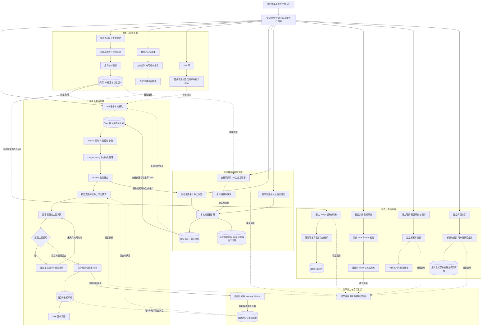
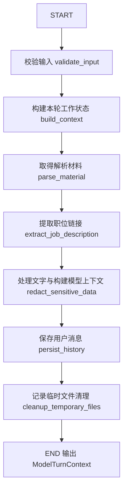
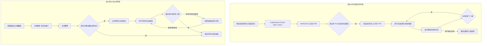

# 求职助手全模块节点架构图

依据 2026-11-13 工作区源码整理。覆盖求职对话、资料、记忆、面经、Skill、岗位搜索、招聘沟通、招呼语、岗位匹配、面试大师及线上笔试；独立简历助手作为关联模块标出。图中的功能模块不都属于 LangGraph。

图例：实线表示主要处理或触发关系，虚线表示共享能力、资料注入或跨轮次复用。数据库节点表示同一 PostgreSQL 内按业务划分的表，不表示把所有记录混成同一种消息。

## 1 全模块功能节点总图

为避免把总图误读为执行细节：工具第六轮仍未结束时会失败；模型或预算异常也可结束 Turn。总图只画成功主路径和主要反馈边，没有展开所有失败分支。图中 TOOLS 返回 LLM 是本轮循环；Memory 更新返回 Prompt 是后续轮次的数据复用；岗位快照返回任务队列是一个新的内部 Turn。

## 2 LangGraph 七节点展开

只有本图中的七步是 `CareerIntakeGraph` 实际注册的节点，当前没有条件边、回边或 checkpointer。

节点通过 `CareerIntakeGraphState` 传递输入、解析材料、岗位快照、模型上下文和完成步骤。主 Worker 路径中的材料已由 API 解析，`parse_material` 主要复用解析产物；清理节点记录进展，实际删除由 API 和 finally 保证。

## 3 面试与笔试的独立节点

实时面试的后端队列在连接内存中，断开后清空，不使用聊天 Worker 的数据库租约恢复。笔试最多两次修复、初次执行加修复后的执行最多三次；关闭自动修复时只执行用户提交的代码。执行器是 Piston 适配器，图示表示代码能力，不代表当前环境已经部署可用的执行服务。

## 4 功能节点与实际实现

| 分区 | 实际入口与实现 | 执行方式 |
| --- | --- | --- |
| 对话提交 | `web/turn_router.py`、`turn_payloads.py` | API 受理后进入 PostgreSQL Turn 队列 |
| 对话执行 | `turn_worker.py`、`agent_loop.py`、`intake_graph.py`、`response_runner.py` | Worker 调度、静态输入图、可选工具循环 |
| 上下文与摘要 | `prompt_context.py`、`context_budget.py`、`conversation_memory.py`、`memory_worker.py` | 本轮编排与独立压缩任务 |
| 多模态资料 | `attachments.py`、`document_parsing.py`、`cloud_vision.py`、`legacy_office.py`、`resume_normalizer.py` | pypdf、Docling、Gotenberg 和按需视觉理解 |
| 面经 RAG | `interview_library/collection.py`、`chunking.py`、`retrieval.py` | 入库切片、可选向量、关键词或混合召回 |
| Skill | `skill_runtime.py`、`skill_tools.py` | 显式调用或会话继承指令；注册工具由服务端执行 |
| 岗位搜索 | `job_search_response.py`、`web/job_search_router.py`、`job_search_analysis.py` | 卡片与扩展交互、版本快照、内部分析 Turn |
| 动态指标 | `job_assessment.py`、`job_match_rules.py` | 固定 Judge、规则复算；当前由 BackgroundTasks 调度 |
| 招呼语与沟通 | `greetings.py`、`external_chat.py`、`web/external_chat_execution_router.py` | 文案生成、人工确认、本机扩展执行与独立历史 |
| 面试大师 | `live_interview/web.py`、`session_manager.py`、`answer_service.py` | WebSocket、ASR、连接内 FIFO |
| 线上笔试 | `online_assessment/web.py`、`solution_service.py`、`execution.py` | 题面分析、代码执行、最多两次修复 |
| 独立简历助手 | `resume_assistant/service.py`、`repository.py` | 建议确认后生成；用户显式保存独立历史 |

## 5 循环边界

| 类型 | 本图中的循环 | 边界 |
| --- | --- | --- |
| 模型工具决策 | LLM → 注册工具 → LLM | 最多六轮模型决策，未逐轮重算预算的问题仍待修复 |
| 代码修复 | 执行 → 测试报告 → 修复 → 执行 | 最多两次修复；仅适用算法题并开启自动修复 |
| 实时面试队列 | 当前题完成 → 下一题 | 连接内串行消费，结束或断线停止 |
| 外部结果反馈 | 搜索结果保存 → 新内部 Turn | 受批次、版本与去重约束，不等于当前工具循环 |
| 跨轮记忆 | 旧历史 → 摘要 → 下一轮 Prompt | 数据复用，非 LangGraph 回边 |
| 调度与心跳 | 领取下一任务、续租 | 基础执行机制，不属于模型思考循环 |

当前保留已记录的租约回收、SSE 游标、历史窗口、摘要规则和指标校验等问题；图示不表示这些缺口已经修复。本文只构建文档，不改变业务实现，不连接生产，不执行真实招聘发送、面试录音或模型调用。

## 6 BOSS 数据获取链路

设计目标是让本机扩展复用用户已经登录的 BOSS 页面，平台消费归一化字段，对话再引用已保存的岗位快照。实际调用顺序为 `JobSearchWorkspace.vue → job-library-bridge.js → content-script.js → service-worker.js → BOSS 标签页 MAIN world → BOSS 内部接口`，返回结果由 `boss-data.js` 整理后沿桥接通道返回网页。

| 数据 | 页面内读取方式 | 结果用途 |
| --- | --- | --- |
| 城市目录 | `/wapi/zpgeek/common/data/city/site.json` | 取得真实城市名称和代码 |
| 岗位列表 | `/wapi/zpgeek/search/joblist.json`，关键词、城市、页码，每页请求 15 条 | 展示摘要并建立对话搜索批次 |
| 岗位详情 | `/wapi/zpgeek/job/detail.json`，列表返回的 securityId | 补齐 JD、地址、公司与招聘者字段 |
| 招聘会话列表 | `/wapi/zprelation/friend/getGeekFriendList.json` | 同步联系人、岗位和最近消息摘要 |
| 所选会话消息 | `/wapi/zpchat/geek/historyMsg` | 保存与展示招聘聊天记录 |

`chrome.scripting.executeScript({ world: 'MAIN' })` 将读取函数放入 BOSS 页面环境，`fetch` 设置 `credentials: 'include'`，由浏览器附带当前会话凭据；扩展不用把 Cookie 交给平台服务器。上述路径属于网页内部接口，接口与字段漂移仍需维护，不等同于公开开放 API。

岗位业务在扩展中串行执行，读取前与上次请求完成时间保持至少一秒间隔；前端也以并发 1 预取本批岗位详情，并合并重复请求、缓存已取得的 JD。遇到登录、验证或限流停止继续预取；符合现有会话恢复规则的异常仅进行一次普通刷新和一次只读重试。Chrome Service Worker 的队列是内存 Promise 链，不提供数据库任务的断点恢复。

对话模式通过 `job_search_router.py` 保存搜索批次、分页和详情，`job_search_repository.py` 保存岗位版本并分配 `S1-J12` 等稳定引用。后续 Turn 冻结批次版本，`job_search_context.py` 在预算内选择摘要和 JD 证据，交由主 Worker 分析；数据库保存范围与单次 Prompt 注入范围不同。用户确认后才将岗位写为目标岗位档案。当前岗位版本可保存 securityId 等桥接字段，模型投影另行筛选，不应将不向模型注入标识等同于数据库不保存标识。

招聘沟通使用独立账号、会话和消息仓储，按真实消息 ID 去重，保留近 30 天记录；页面每 30 秒尝试刷新，但受页面可见性、扩展、登录和活动执行资格约束，只读取列表及所选会话消息。它与 AI 聊天历史分开，不代表自动把 HR 聊天全文注入主对话。本节依据源码核对，没有执行真实 BOSS 请求或收发操作；文档范围问题记为 DOC-005，待讨论结束后集中处理。
