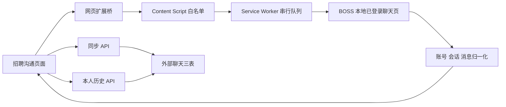

# BOSS 收件模块

更新日期：2026-11-09。只读首版后，当前候选实现继续加入源分页、共享账号暂停、活动执行端和人工确认回复，插件候选版本为 0.6.0。新增部分仍需真实账号验收，不能将下方旧版测试记录当作新版上线结论；当前发布判断见 [上线审查](../reviews/2026-11-09-boss-inbox-release.md)。

## 使用与实际边界

进入“求职助手 → 招聘沟通”（`/career/messages`）。安装或重新加载 0.6.0 浏览器助手，在同一 Chrome/Edge 登录 BOSS 求职者账号。页面先显示平台历史，再取得当前账号执行资格并同步会话列表；选择联系人后读取正文。页面可见且连接就绪时每 30 秒尝试同步列表与当前会话，其他会话只更新摘要。图片、文件、语音只显示类型并提供源平台入口。

新 HR 回复在列表下一次成功同步时出现摘要；正文在选中该会话后读取。浏览器或页面关闭、设备休眠、断网、BOSS 登录失效时不会继续收件；重开后再读取源平台仍可取得的记录。换设备可查平台已同步历史，继续读取需要该设备自己的浏览器助手与 BOSS 登录态。没有固定实时性或源平台完整历史承诺。

平台级验证、登录、限流和账号变化会暂停自动同步，处理后手动继续。后台请求不会自动解验证码或刷新登录。当前候选版本的持续回复需要用户逐条确认，并取得账号执行资格；初次建联与持续回复分开。点击“到 BOSS 回复”只是打开正常聊天页；自动操作触发提交也不能描述为 HR 已收到。

## 调用链



- `web-ui/src/external-chat-client.js`：同步编排、可见性轮询、暂停与账号核对；`components/CareerMessagesPage.vue`：独立 PC 会话页。
- `job-library-bridge.js` → `content-script.js` → `service-worker.js`：能力 `boss_chat_read`；动作 `boss_chat_state`、`boss_chat_list`、`boss_chat_messages`。连接 ping 不排在业务请求后。
- `boss-chat-page.js`：MAIN world 中的自包含只读读取器，限制求职者列表和历史 GET，身份缺失或变化时返回错误。
- `boss-chat.js`：提取平台消息 ID、方向、原始时间和消息类型，不按正文或姓名猜测身份。
- `src/career_assistant/web/external_chat_router.py` → `external_chat.py` → `persistence/external_chat_repository.py`：复用轻量 CareerDatabase 和当前请求 Actor，不初始化 LLM，不混入 AI 会话表。

聊天标签页独立于岗位搜索页；缺失时创建非激活的正常聊天页。列表同步不逐个打开未选联系人，也不承诺隐形阅读。securityId 仅在浏览器内瞬态使用，不持久化到平台或扩展 storage；不导出 Cookie、登录令牌或原始响应。

## 接口与存储

统一前缀 `/api/career/external-chat`。

| 方法及路径 | 行为 |
| --- | --- |
| `GET /accounts` | 当前登录用户的外部账号 |
| `GET /accounts/{id}/conversations` | 当前用户所选账号的有效摘要 |
| `GET /conversations/{id}/messages?limit=100&before=…` | 最近 30 天正文，`before` 为上一页最早消息的内部 UUID；按源时间和内部 ID 稳定翻页，结果正序 |
| `POST /sync` | 导入 `{account,conversations,messages}`，忽略过期记录、按平台真实消息 ID 去重 |

账号外部稳定 UID、会话平台 ID 和消息平台 ID 都使用字符串。服务端内部 UUID 只用于历史 API；浏览器 accountId 使用 `platform_account_id`，两者不可互换。每条查询和写入从服务端 Actor 确定用户归属。迁移 `20261109_35_external_chat.py` 新增账号、会话、消息三表，不改 LLM 消息语义。

近 30 天按平台源消息时间 UTC 滚动计算；未知时间不能冒充新消息。导入、查询和摘要均过滤到期内容。API 生命周期启动补清并每 60 秒清理到期行及摘要；停机取消任务，未配置数据库不启动。联系人标识可保留，但过期正文、摘要和媒体占位不得继续展示或保存。

## 参考实现与取舍

2026-11-05 的固定源码调研给出了求职者列表及历史读取依据：

| 项目 | 固定版本 | 采用方式 |
| --- | --- | --- |
| [can4hou6joeng4/boss-agent-cli](https://github.com/can4hou6joeng4/boss-agent-cli/tree/b6e5a0aca58bb67116ed0cfc32febed253802092) | `b6e5a0a…`，MIT | 求职端路由、稳定 UID、未读及摘要字段参考；不使用其招聘者回复命令 |
| [jackwener/OpenCLI](https://github.com/jackwener/OpenCLI/tree/97dc0cd5214b9602bcda78d7422f231ee8a803e9) | `97dc0cd…`，Apache-2.0 | 求职端历史读取参数参考；不引入 CLI、MCP、CDP 或其整套依赖 |

两者用于核对协议字段，本项目自行实现扩展读取和持久化。没有采用 MQTT 逆向、代理池、指纹伪装或云端托管登录态。BOSS 使用内部网页接口，官方页面或字段变化仍可能导致读取失败，代码与离线测试不能替代真实求职账号验收。详细证据索引为 `.firecrawl/2026-11-05-boss-chat-sources/evidence.json`。

## 0.5.0 首版验证记录

本地验证已通过：

| 验证 | 结果 |
| --- | --- |
| 扩展全部 Node 测试（含 MAIN 序列化及真实 SW 分发） | 76 passed |
| Web UI 全部 Node 测试（含入站编排、导航和网页桥） | 324 passed |
| 外部聊天、历史快速路径及原打招呼 API pytest | 29 passed，无 skip；使用真实 loopback PostgreSQL 隔离临时库 |
| PC Chromium E2E | 7 passed，模拟 HR 新回复、按点击读取、迟到限流、历史刷新保留及真实应用入口/路由 |
| 扩展发行包 pytest | 2 passed，0.5.0 ZIP 含新增文件且全部文件与源码字节一致 |
| Vite 构建、Service Worker 语法检查 | 通过；现有大 chunk 提示仍在 |

关键命令：

```powershell
node --test browser-extension/job-library/tests/*.test.mjs
# 以下两项在 web-ui 目录执行
node --test src/*.test.js
npx playwright test e2e/boss-inbox.spec.js e2e/boss-inbox-route.spec.js --project=chromium --reporter=line
npm run build -- --logLevel warn
# 以下在项目根目录执行
.\.venv\Scripts\python.exe -m pytest tests/test_external_chat.py tests/test_career_history_fast_path.py tests/test_career_greeting_api.py tests/test_boss_extension_distribution.py -q
.\.venv\Scripts\python.exe scripts/package_boss_extension.py
```

本地开发库在核对 loopback、端口 `54329`、库名 `career_assistant` 和基线 `20261104_34` 后，已执行 Alembic 升级至 `20261109_35`，三张新表存在。真实本地 API smoke：账号历史 GET 返回 200/空列表，未知账号及会话返回 404；清理任务启动/停止正常，未初始化完整 LLM 服务，未向开发库写入模拟聊天。测试临时库已清理。

集成复核已修复：切会话后旧请求的账号级限流不再丢失；在途列表刷新不能覆盖后发生的暂停；刷新新消息不覆盖用户已加载的更早历史及分页边界；同源时间优先保留权威列表摘要；未开启 AI 对话时也能进入招聘沟通。

PC 截图 `output/boss-inbox/boss-inbox-pc-simulated.png` 明确标记模拟数据，只用于页面验收。真实浏览器验证已尝试：Chrome 可发现，但当前环境没有可用标签页且不支持通过扩展新建窗口，因此尚未获取真实登录态或 HR 私聊；没有对外发送、投递或连接生产。

## 后续边界

真实求职账号需核对 UID、两个已有会话、HR 新回复、媒体类型和正常已读行为。源平台列表/历史分页与完整记录补齐必须按实际响应继续验证。继续回复需另行完成身份冻结、人工草稿保护和可证实提交状态，不能直接复用首次打招呼。猎聘、前程无忧适配另见跨平台调研，不能因 BOSS 适配器存在而视为已打通。

## 本地 Not Found 故障排查（2026-11-09）

症状：账号与最后同步时间已经显示，会话为空；顶部是裸 `Not Found`，连接状态一直停在“正在连接浏览器助手”。

本次日志 `tmp/regression-20261109/import-api-final.log` 确认基础账号/同步接口 200，但 `POST /accounts/{id}/execution` 与 `GET /accounts/{id}/operations` 返回裸路由 404。真实 `18080/openapi.json` 只有首版 4 条外部聊天路径；API 进程于 13:30 启动，没有热重载，早于执行层接口加入。源码安装链没有漏注册，旧运行实例没有加载新路由。此时尚未调用 BOSS 会话列表，不能据此认定 BOSS 拦截。

处理：核对为本地项目旧进程及 loopback 开发数据库后，仅重启本地 API，并开启现有开发热重载；未动生产。新进程日志为 `tmp/boss-inbox-local-api.stdout.log` 与 `tmp/boss-inbox-local-api.stderr.log`。重启后真实 OpenAPI 有全部 14 条路径；账号 GET 200，执行接口空参数返回业务 422，未知账号返回结构化 `external_chat_not_found`，不再是裸 `Not Found`。现有 5176、5177 前端代理也已验证接到新版接口。只读确认截图账号记录仍在，数据库版本为 `20261109_37`，没有删除历史或写入模拟聊天。

前端 `createExternalChatClient` 仅把 HTTP 404 且裸 `detail: 'Not Found'` 归类为 `backend_route_unavailable`，显示中文后端未就绪提示，状态为 `service_unavailable`。结构化账号/会话不存在的业务 404 保持原义。错误附状态码、路径及方法，不携带正文或凭据。服务未就绪时停止后续插件探测和自动源请求，用户手动重检后可恢复。

回归：`external-chat-service-compatibility.test.js` 新增 4 项，连同 client/execution/visibility 共 47 项通过；`tests/test_external_chat_route_installation.py` 使用真实 Career 安装入口核对 14 条路径及方法，1 项通过且不连接数据库/LLM；Vite 构建通过。用户刷新原页面后再点“立即同步”，真实 HR 收件仍以其后的源同步结果为准。

### 2026-11-09 方案复审补充

用户已确认两轮全部推荐：选中会话按需补齐源平台仍可取得的最近 30 天历史；首期仅前台同步，切回立即尝试补齐；同一 BOSS 账号只保留一个活动执行端，其他页面或设备查看平台历史，账号暂停统一约束；切换执行端手动接管；离页或超时使尚未提交的操作失效；未知结果保留核对，旧操作不重发，新消息另行确认。完整目标与发送契约见 [双向沟通设计](../designs/2026-11-05-boss-chat-bridge-design.md)。

复审确认的以下缺口现已完成本地修正，真实账号行为仍待验收：

- **源分页**：网页桥、Service Worker 和源读取器完整传递 page/count；前端逐页保存列表和当前正文，并以已确认完整区间做增量衔接。has_more 缺失保留未知；重复页、未知结束和中断显示缺口，不把数据库翻页当作源补齐。
- **统一暂停**：服务端账号行与扩展 storage 共同保存暂停，跨页面、重载和执行端接管不能自动解除；人工处理后由活动端手动继续。真正源请求前仍检查共享状态。
- **单活动执行端**：账号行锁协调 90 秒执行资格，check 续期，手动接管提升 revision；旧端不可领取新动作，可能提交的旧操作先收尾或等待原 30 秒执行期限。非活动端显示“仅查看历史”和“在此接管”。
- **独立发送操作**：新增 external_chat_operations 与操作 API，冻结目标和正文；30 秒执行期限与 30 天内容保留分别处理。同 ID 不重复执行，离页/超时/取消走失效控制，提交不确定保留待核对；PC 已增加逐条确认文本回复与源平台核对入口。

上述修正已经本地数据库、扩展和 PC 模拟验证，但不是新的真实账号验收。原首版记录保留其执行时范围；真实使用仍须依次核验只读契约、源分页和执行约束，最后受控验收持续回复。


## 0.6.0 调用链与接口补充

页面通过 execution API 取得或手动接管执行资格；网页 bridge 的 list/messages/reply 带 `{account_id,executor_id,revision}`。Service Worker 在真正执行前，注入发起页面的 `boss-chat-control.js`，用同源登录身份复查服务端资格、可见性、账号、操作与冻结会话；不把 Cookie 传给扩展或 BOSS。

`boss-chat-dispatch.js` 编排源读取及单次回复；`boss-chat-reply-page.js` 分 inspect/prepare/submit/cancel，在草稿保护后受控定位，并分别核对稳定 UID。`boss_chat_cancel` 绕过业务队列，源页短期墓碑阻止取消后的晚执行；结束后清理正文和输入框引用。网页隐藏恢复带可见性版本，旧请求不能恢复旧链路或阻塞新刷新。

新增 API 均位于 `/api/career/external-chat`，并由服务端 Actor 限定本人归属：

| 方法及路径 | 行为 |
| --- | --- |
| `POST /accounts/{id}/execution` | 申请或续持执行资格；takeover 明确手动接管 |
| `POST /accounts/{id}/execution/check` | 检查当前执行端及版本并续期 |
| `POST /accounts/{id}/execution/release` | 失效旧待发操作，释放资格 |
| `POST /accounts/{id}/pause`、`/resume` | 账号统一暂停及当前端手动恢复 |
| `POST /conversations/{id}/operations` | 先创建冻结发送操作，再允许扩展分发 |
| `GET /accounts/{id}/operations`、`GET /operations/{id}` | 查询状态，刷新不重发 |
| `POST /operations/{id}/transition`、`/cancel` | 条件状态转换与即时失效 |

操作响应增加 retain_until，前端暂停或离线时也清理到期操作正文。accepted 必须有精确源消息 ID 及同会话 outgoing、本人发送方和冻结正文证据；当前扩展只报告提交层级，没有证据就保留待核对。platform_rejected:<code>:<说明> 是明确业务拒绝的适配器契约，目前没有启用真实业务拒绝提升路径；普通传输错误不能冒充失败回执。

## 0.6.0 本地验证记录

| 验证 | 结果 |
| --- | --- |
| 扩展全部 Node，包括实际 SW、分页、共享暂停、即时取消和受控定位 | 94 passed，无 skip |
| Web UI 全部 Node，包括源120条、跨页面执行、隐藏/离页、同文新操作 | 362 passed，无 skip |
| 外部聊天、执行、历史快速路径、原打招呼 API pytest | 57 passed，无 skip，使用真实 loopback 隔离 PostgreSQL |
| 发行包与完整 Alembic 升级链 | 4 passed，递归 import 完整，全部源码字节一致，旧消息保留 |
| PC Chromium E2E | 10 passed，全部使用模拟数据和扩展 |
| Vite 构建 | 通过，现有大 chunk 提示仍在 |

关键命令：

```powershell
node --test browser-extension/job-library/tests/*.test.mjs
.\.venv\Scripts\python.exe -m pytest tests/test_external_chat.py tests/test_external_chat_execution.py tests/test_career_history_fast_path.py tests/test_career_greeting_api.py -q
.\.venv\Scripts\python.exe scripts/package_boss_extension.py
.\.venv\Scripts\python.exe -m pytest tests/test_boss_extension_distribution.py tests/test_boss_inbox_release.py -q
# 在 web-ui 目录执行
node --test src/*.test.js
npx playwright test e2e/boss-inbox.spec.js e2e/boss-inbox-route.spec.js --project=chromium --reporter=line
npm run build -- --logLevel warn
```

本地开发数据库已再次核对为 `127.0.0.1:54329/career_assistant`，从现有 20261109_36 升级到 20261109_37；没有修改其他任务的 36 迁移。真实本地数据库轻量 API smoke：账号 GET 200，未知执行账号及操作 404，清理启动/停止正常，未初始化 LLM、未写入模拟聊天。

真实浏览器核验因工具无法可靠确认现有窗口 URL 自动停止；没有绕过停止指令继续读取账号，没有真实发送或生产连接。真实求职端 UID、列表 GET 契约、分页结束信号、Vue/DOM 会话标识、已读副作用及单条收发仍待验收。0.6.0 ZIP 已生成，安装后须重新加载扩展并刷新网页；该发行包只代表本地候选完成。
